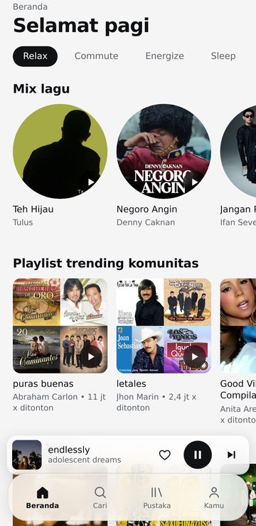
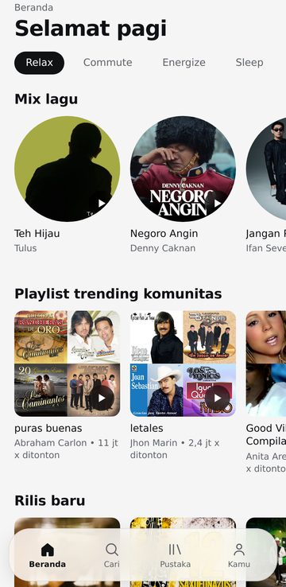
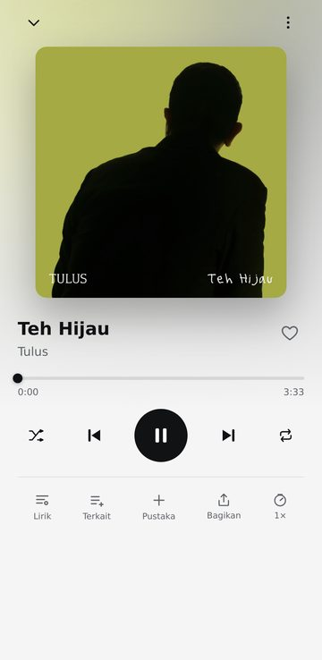
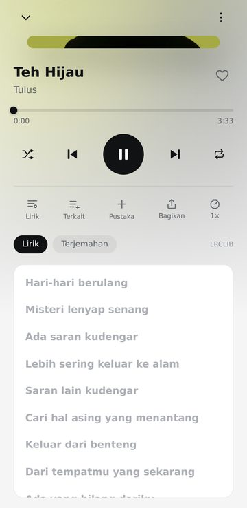
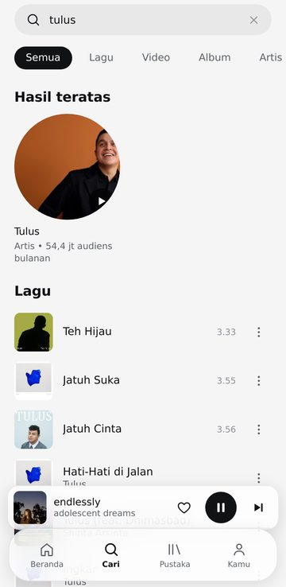
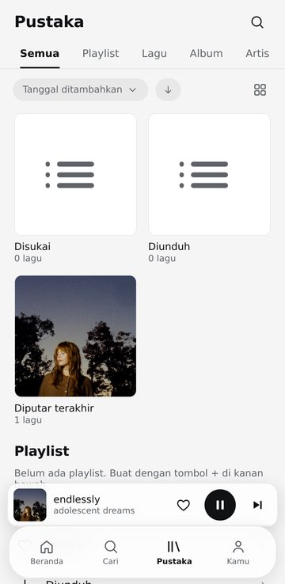
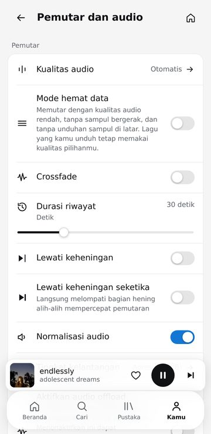
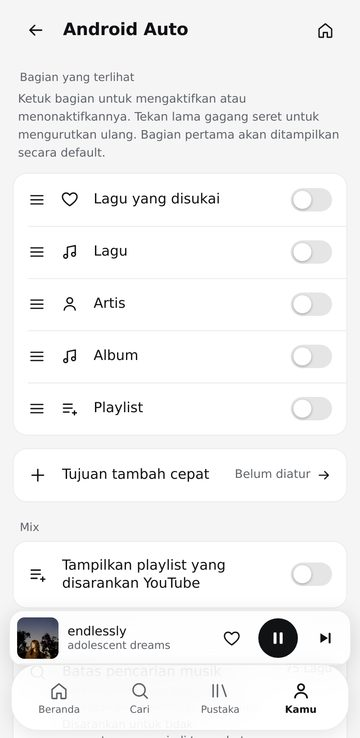
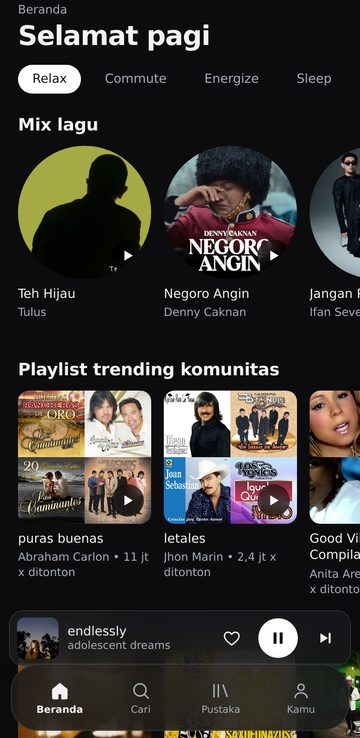

<div align="center">



# 🎧 Auralys

**Pemutar musik bergaya YouTube Music — Bahasa Indonesia, lengkap, dan bisa dipasang sebagai aplikasi.**

[](../../actions/workflows/ci.yml)
[](LICENSE)
[](package.json)
[](public/manifest.webmanifest)

</div>

---

## ✨ Tentang

Auralys adalah **klien musik web (PWA)** yang mengambil katalog asli dari **YouTube Music**
lewat backend kecil berbasis Express + InnerTube — tanpa API key. Audio diputar memakai
**YouTube IFrame Player** resmi, jadi tidak perlu mengekstrak stream (yang diblokir YouTube).

Antarmuka dibuat ulang mengikuti aplikasi pemutar musik modern: Beranda, Cari, Pustaka,
mini-player, pemutar penuh dengan **lirik tersinkron**, radio otomatis, playlist, unduhan,
serta **seluruh layar pengaturan** (audio, tampilan, konten, lirik, privasi, penyimpanan,
cadangan, Android Auto, tautan, tentang).

<div align="center">
  
  
  
  
</div>
<div align="center">
  
  
  
  
</div>

---

## 🚀 Menjalankan

```bash
# 1. clone & masuk folder
git clone https://github.com/USERNAME/auralys.git
cd auralys

# 2. pasang dependensi
npm install

# 3. jalankan
npm start          # ➜ http://localhost:8080
```

Butuh **Node.js 18+** dan koneksi internet (katalog & pemutaran dari YouTube Music).
Mode pengembangan dengan auto-reload: `npm run dev`.

---

## 🌐 Deploy (jadikan aplikasi online)

Aplikasi ini **butuh proses Node.js** (bukan situs statis), karena backend mengambil data
dari YouTube Music. Pilih salah satu — semuanya gratis untuk mulai:

<details open>
<summary><b>Railway</b> (paling cepat)</summary>

1. Buka [railway.app](https://railway.app) → **New Project** → **Deploy from GitHub repo**.
2. Pilih repo `auralys`. Railway otomatis mendeteksi Node dan menjalankan `npm start`.
3. Klik **Generate Domain** → aplikasi online. `PORT` diisi otomatis oleh Railway.
</details>

<details>
<summary><b>Render</b> (ada `render.yaml`)</summary>

1. [render.com](https://render.com) → **New** → **Blueprint** → pilih repo ini.
2. Render membaca `render.yaml` (build: `npm ci --omit=dev`, start: `node server.mjs`).
3. Selesai — health check di `/api/health`.
</details>

<details>
<summary><b>Vercel</b></summary>

```bash
npm i -g vercel
vercel            # ikuti wizard (framework: Other)
vercel --prod
```
Berkas `vercel.json` sudah menyiapkan semua request diarahkan ke `server.mjs`.
</details>

<details>
<summary><b>Fly.io</b></summary>

```bash
fly launch --name auralys      # gunakan Dockerfile yang disertakan
fly deploy
```
</details>

<details>
<summary><b>VPS / Docker</b></summary>

```bash
docker build -t auralys .
docker run -d --name auralys -p 8080:8080 --restart unless-stopped auralys
```

Atau tanpa Docker:

```bash
npm ci --omit=dev
pm2 start server.mjs --name auralys   # disarankan pakai reverse proxy + HTTPS
```
</details>

<details>
<summary><b>Pasang di HP (PWA)</b></summary>

Setelah online (HTTPS), buka di Chrome/Edge/Safari →
menu ⋮ → **Tambahkan ke layar utama**. Aplikasi berjalan fullscreen seperti app native
(manifest + service worker sudah disertakan).
</details>

---

## 🗂️ Struktur proyek

```
auralys/
├── server.mjs              # Express: /api/* + server statis (SPA fallback)
├── lib/
│   ├── ytmusic.mjs         # klien InnerTube: search, beranda, album/artis/playlist, radio
│   └── lyrics.mjs          # lirik publik + LRC tersinkron (LRCLIB)
├── public/
│   ├── index.html          # shell aplikasi (splash, tabbar, mini-player)
│   ├── css/style.css       # tema terang / gelap / hitam
│   ├── js/
│   │   ├── app.js          # router + topbar/tabbar
│   │   ├── core.js         # state, localStorage, toast, sheet, menu, util
│   │   ├── player.js       # mesin pemutar, antrean, mini-player, pemutar penuh, lirik
│   │   ├── home.js         # Beranda            ├── search.js  # Cari
│   │   ├── browse.js       # album/artis/playlist├── library.js # Pustaka & playlist
│   │   ├── settings.js     # Kamu + semua layar pengaturan
│   │   └── ui.js, icons.js, api.js
│   ├── manifest.webmanifest, sw.js, icons/
├── docs/screenshots/       # gambar untuk README
├── Dockerfile, render.yaml, vercel.json, Procfile
└── .github/workflows/ci.yml
```

### Endpoint API

| Endpoint | Fungsi |
|---|---|
| `GET /api/home` | Beranda YouTube Music (mix, trending, rilis baru, tangga lagu) |
| `GET /api/search?q=` | Pencarian: lagu, video, album, artis, playlist, podcast |
| `GET /api/suggest?q=` | Saran pencarian (autocomplete) |
| `GET /api/browse?id=` | Halaman album (`MPRE…`), artis (`UC…`), playlist (`VL…`) |
| `GET /api/next?videoId=` | Radio mix — lagu terkait & antrean (otomatis `RDAMVM…`) |
| `GET /api/lyrics?videoId=&title=&artist=` | Lirik (LRC tersinkron bila tersedia) |
| `GET /api/health` | Status server (dipakai health check hosting) |

---

## 🧩 Fitur

**Beranda** — sapaan sesuai waktu, chip mood (Relax · Commute · Energize · Sleep · Sad ·
Feel good), Mix lagu, Playlist trending komunitas, Rilis baru, tangga lagu Indonesia.

**Cari** — autocomplete saat mengetik, filter Semua/Lagu/Video/Album/Artis/Playlist/Podcast,
riwayat pencarian, kartu hasil teratas.

**Pustaka** — tab Semua · Playlist · Lagu · Album · Artis · Podcast, urutkan, tampilan
grid/list, koleksi **Disukai, Diunduh, Cache, Di perangkat, Teratas saya 50, Diunggah**;
playlist bisa dibuat, diganti nama, dihapus, dan diisi dari menu ⋮ pada lagu mana pun.

**Pemutar**
- Mini-player: suka, putar/jeda, berikutnya, progress bar, **geser untuk ganti lagu**
  (sensitivitas bisa diatur).
- Pemutar penuh: sampul blur adaptif, seek, acak, ulangi (semua/satu), kecepatan 0,5×–2×.
- **Lirik tersinkron** dari LRCLIB — baris aktif menyala & menggulir otomatis.
- Tab **Terkait** (antrean radio), tambah ke pustaka, bagikan, buka di YouTube Music.
- **Media Session API** — kontrol di layar kunci/notifikasi; **Wake Lock** (layar tetap nyala).

**Pengaturan (semua tersimpan permanen di perangkat)**
- *Suara dan pemutaran*: kualitas audio, mode hemat data, crossfade, durasi riwayat,
  lewati keheningan (+seketika), normalisasi audio, tingkat kelantangan, audio offload,
  varispeed; *antrean*: konten serupa, pertahankan acak, ingat status acak/ulang,
  acak playlist dahulu, cegah lagu sama, lewati otomatis jika kesalahan; *lainnya*:
  hentikan saat aplikasi ditutup, jeda saat media dibisukan, lanjutkan Bluetooth,
  jaga layar menyala, sampul animasi, mode video, putar video otomatis.
- *Tampilan*: mini-player/pemutar desain baru, gaya latar, sembunyikan thumbnail,
  sampul layar penuh, pangkas sampul album, warna tombol, gaya slider, geser ganti lagu,
  sensitivitas geser, **tema terang/gelap/hitam/ikuti sistem**, lirik eksperimental.
- *Bahasa dan konten*: bahasa & negara konten, sembunyikan eksplisit/video musik/video
  pencarian/Shorts, utamakan versi audio, posisi penambahan playlist, halaman artis,
  bahasa aplikasi, terjemahan lirik.
- *Privasi dan riwayat* (hapus riwayat putar/cari) · *Penyimpanan* (hapus cache/unduhan) ·
  *Cadangan dan impor* (ekspor/impor JSON, setel ulang) · **Android Auto** (bagian yang
  terlihat + urutkan, tujuan tambah cepat, playlist saran YouTube, batas pencarian 75 lagu) ·
  *Tautan* · *Tentang Auralys* · *Akun* (ubah nama profil, sinkronisasi).

---

## ⚠️ Catatan penting

1. **Katalog & pemutaran dari YouTube Music.** Aplikasi memakai InnerTube (tanpa API key)
   dan YouTube IFrame Player untuk audio — cara paling andal dan tidak mengekstrak stream.
   Karena itu dibutuhkan koneksi internet; tombol **Unduh** menandai lagu agar tersedia
   di pustaka offline, bukan menyimpan salinan audio.
2. **Data pribadi tersimpan lokal** (`localStorage`): playlist, lagu disukai, riwayat,
   dan pengaturan tidak dikirim ke server mana pun. Cadangkan lewat menu *Cadangan dan impor*.
3. **Bukan aplikasi resmi.** Proyek ini untuk pembelajaran/portofolio; seluruh hak cipta
   musik dan konten tetap milik pemegang haknya. Gunakan secara bertanggung jawab.
4. Fungsi pengaturan yang murni perangkat (mis. audio offload, Android Auto, sampul animasi)
   tersimpan sebagai preferensi dan memengaruhi perilaku aplikasi sejauh yang didukung web.

---

## 🤝 Kontribusi

```bash
git checkout -b fitur-baru
# ...ubah kode, lalu jalankan: npm run dev
git commit -m "feat: deskripsi singkat"
git push origin fitur-baru
```
Buka Pull Request — CI akan memeriksa sintaks dan memastikan server + API `/api/health`
berjalan. Silakan buka *Issue* untuk laporan bug atau ide fitur.

## 📄 Lisensi

[MIT](LICENSE) © 2026 Auralys contributors
# Musik-
